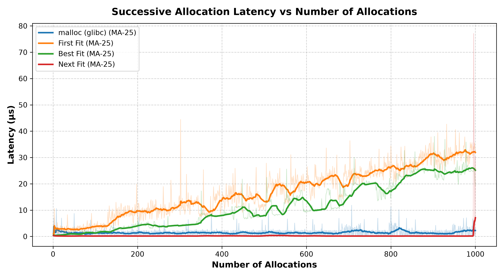
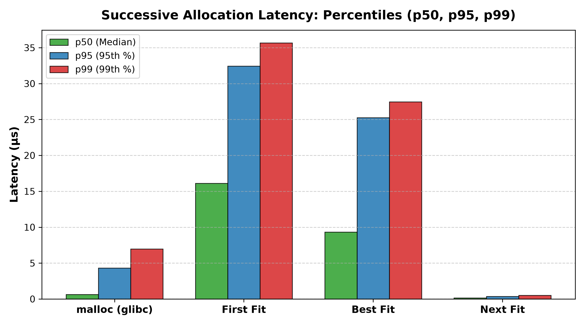
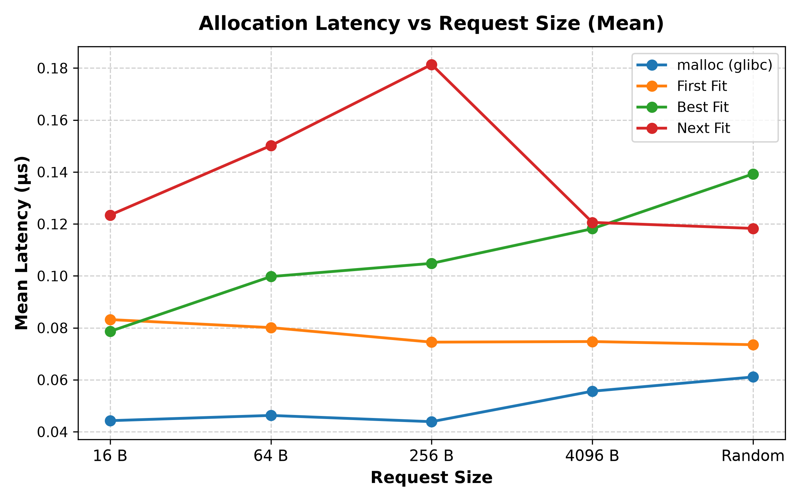
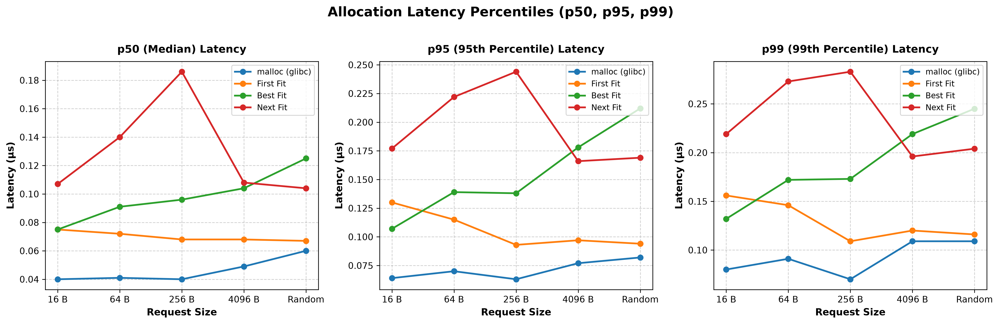
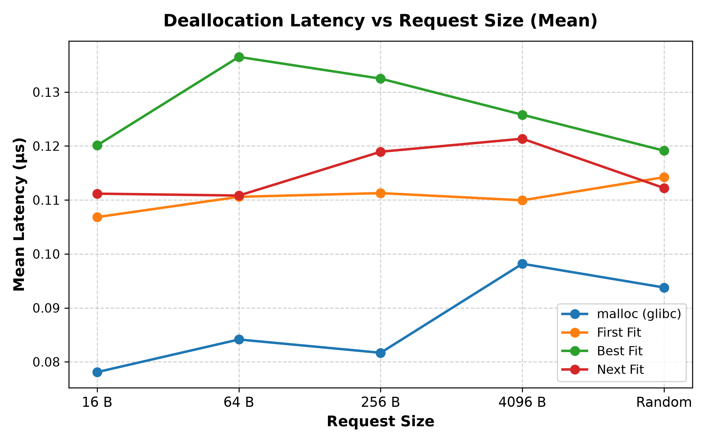
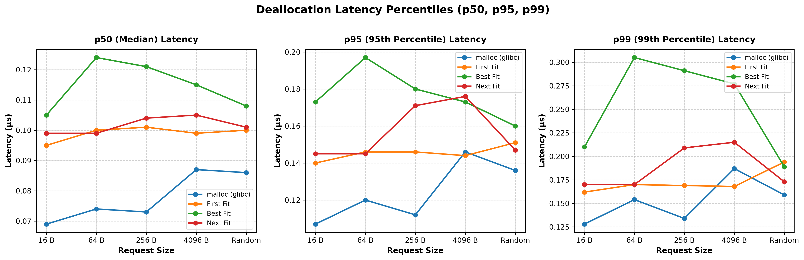
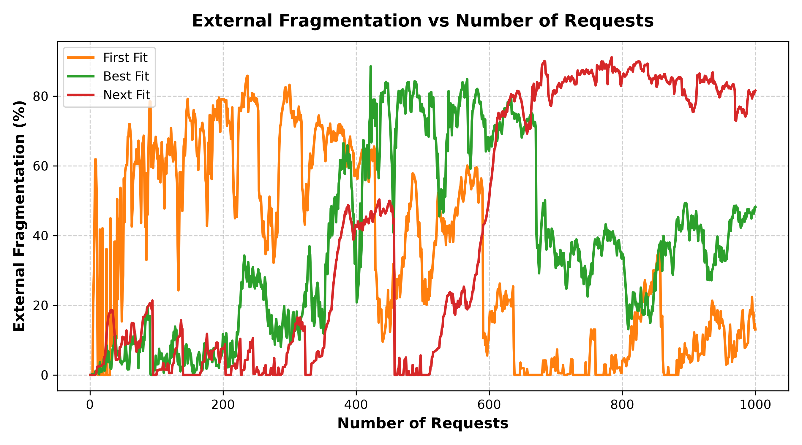

# memcpp
Lightweight, thread-safe C++ memory management library featuring custom allocation strategies, boundary coalescing, and configurable memory alignment.

## Features
- **Process Memory Management:** Custom heap allocator managing user-space memory pools via `sbrk`.
- **Multiple Allocation Strategies:** Supports First Fit, Best Fit, and Next Fit free-list search policies.
- **Byte Alignment:** Configurable natural, power-of-2, cache-line (64B), and page (4096B) alignments.
- **Free Block Coalescing:** Automatically merges physically adjacent free blocks on `mem_free` to mitigate external fragmentation.
- **Thread Safety:** Mutex synchronization protecting shared allocator metadata across threads.
- **Introspection API:** Runtime `Stats` reporting allocated/free blocks, memory usage, and fragmentation metrics.

---

## How To Install

### Prerequisites
- CMake 3.20+
- C++20 compliant compiler (`g++` or `clang++`)
- Google Test (for running the test suite)

### Build and Install
```bash
git clone https://github.com/ibrahimamam1/memcpp
cd memcpp
mkdir build && cd build
cmake ..
make -j$(nproc)
sudo make install
```

### Running Tests
```bash
./build/runTests
```

---

## How To Use

```cpp
#include <alloc.hpp>
#include <alignment.hpp>
#include <iostream>

int main() {
    // 1. Basic allocation (defaults to first-fit search)
    void* ptr = mem_alloc(64);

    // 2. Specific search strategies
    void* ptr_ff = mem_alloc_first_fit(128); // First Fit
    void* ptr_bf = mem_alloc_best_fit(256);  // Best Fit
    void* ptr_nf = mem_alloc_next_fit(512);  // Next Fit

    // 3. Aligned allocation (e.g. 64-byte cache line alignment)
    void* ptr_aligned = mem_alloc_align(1024, Alignment::ALIGN_CACHE_LINE);

    // 4. Query memory statistics
    Stats stats = get_stats();
    std::cout << "Allocated blocks: " << stats.n_blocks_allocated << "\n"
              << "Total memory:     " << stats.total_mem << " bytes\n";

    // 5. Free memory (automatically coalesces adjacent free blocks)
    mem_free(ptr);
    mem_free(ptr_ff);
    mem_free(ptr_bf);
    mem_free(ptr_nf);
    mem_free(ptr_aligned);

    return 0;
}
```

### To Compile Your Application
```bash
g++ -std=c++20 my_file.cpp -lmemcpp -o my_app
```

---

## Benchmarks

Comprehensive benchmarks evaluate `memcpp`'s allocation policies against each other and against standard glibc `malloc`/`free` on Linux x86_64.

### Running the Benchmarks

```bash
# Compile benchmark runner
g++ -std=c++20 bench/runner.cpp src/alloc.cpp src/alignment.cpp -Iinclude -o exp

# Run all experiments or select a specific one:
./exp all          # Runs all 4 benchmarks
./exp successive   # Successive allocation latency
./exp alloc        # Allocation latency vs request size
./exp dealloc      # Deallocation latency vs request size
./exp frag         # Fragmentation experiment

# Generate plots
python3 bench/plot.py
```

All generated graphs are saved to `bench/plots/`.

---

### 1. Successive Allocation Latency

This experiment measures the latency of 1,000 successive allocations without intermediate frees, testing how list traversal overhead scales as the heap grows.

| Subject | Mean Latency ($\mu\text{s}$) | Median (p50, $\mu\text{s}$) | 95th Percentile ($\mu\text{s}$) | 99th Percentile ($\mu\text{s}$) | Complexity |
| :--- | :---: | :---: | :---: | :---: | :---: |
| **Next Fit** | **0.35** | **0.16** | **0.38** | **0.51** | $\mathcal{O}(1)$ |
| **glibc malloc** | 1.45 | 0.63 | 4.31 | 6.98 | Multi-arena / Bins |
| **Best Fit** | 11.52 | 9.32 | 25.24 | 27.46 | $\mathcal{O}(N)$ (Full scan) |
| **First Fit** | 17.18 | 16.12 | 32.44 | 35.65 | $\mathcal{O}(N)$ (Head scan) |

<p align="center">
  
</p>

<p align="center">
  
</p>

> **Key Takeaway:** **Next Fit** achieves near-$\mathcal{O}(1)$ allocation time (~0.16 $\mu$s median) because it resumes searching from `last_allocated`, directly appending to the free list without re-scanning previously allocated blocks. In contrast, **First Fit** and **Best Fit** scan the growing list from the head ($\mathcal{O}(N)$), resulting in linear latency growth.

---

### 2. Allocation Latency vs. Request Size

Evaluated across 100,000 allocations per request size (16 B, 64 B, 256 B, 4096 B, and uniformly distributed random sizes in $[16, 4096]$ B) with immediate deallocation.

| Subject | 16 B (Mean) | 64 B (Mean) | 256 B (Mean) | 4096 B (Mean) | Random [16–4096 B] |
| :--- | :---: | :---: | :---: | :---: | :---: |
| **glibc malloc** | 0.044 $\mu\text{s}$ | 0.046 $\mu\text{s}$ | 0.044 $\mu\text{s}$ | 0.056 $\mu\text{s}$ | 0.061 $\mu\text{s}$ |
| **First Fit** | 0.083 $\mu\text{s}$ | 0.080 $\mu\text{s}$ | 0.075 $\mu\text{s}$ | 0.075 $\mu\text{s}$ | 0.074 $\mu\text{s}$ |
| **Best Fit** | 0.079 $\mu\text{s}$ | 0.100 $\mu\text{s}$ | 0.105 $\mu\text{s}$ | 0.118 $\mu\text{s}$ | 0.139 $\mu\text{s}$ |
| **Next Fit** | 0.123 $\mu\text{s}$ | 0.150 $\mu\text{s}$ | 0.181 $\mu\text{s}$ | 0.121 $\mu\text{s}$ | 0.118 $\mu\text{s}$ |

<p align="center">
  
</p>

<p align="center">
  
</p>

> **Key Takeaway:** For isolated alloc/free cycles, **First Fit** performs consistently fastest among custom policies (~0.07–0.08 $\mu$s), closely trailing glibc `malloc` (~0.04–0.06 $\mu$s). **Best Fit** incurs additional overhead scanning the list to find the minimum viable block.

---

### 3. Deallocation Latency

Evaluated across 100,000 free operations per request size. `mem_free` performs bidirectional boundary coalescing with adjacent free blocks in physical memory.

| Subject | 16 B (Mean) | 64 B (Mean) | 256 B (Mean) | 4096 B (Mean) | Random [16–4096 B] |
| :--- | :---: | :---: | :---: | :---: | :---: |
| **glibc malloc** | 0.078 $\mu\text{s}$ | 0.084 $\mu\text{s}$ | 0.082 $\mu\text{s}$ | 0.098 $\mu\text{s}$ | 0.094 $\mu\text{s}$ |
| **First Fit** | 0.107 $\mu\text{s}$ | 0.111 $\mu\text{s}$ | 0.111 $\mu\text{s}$ | 0.110 $\mu\text{s}$ | 0.114 $\mu\text{s}$ |
| **Next Fit** | 0.111 $\mu\text{s}$ | 0.111 $\mu\text{s}$ | 0.119 $\mu\text{s}$ | 0.121 $\mu\text{s}$ | 0.112 $\mu\text{s}$ |
| **Best Fit** | 0.120 $\mu\text{s}$ | 0.137 $\mu\text{s}$ | 0.132 $\mu\text{s}$ | 0.126 $\mu\text{s}$ | 0.119 $\mu\text{s}$ |

<p align="center">
  
</p>

<p align="center">
  
</p>

> **Key Takeaway:** Deallocation latency is uniform across all request sizes (~0.10–0.13 $\mu$s), with First Fit and Next Fit achieving the fastest free times while maintaining adjacent block coalescing.

---

### 4. Memory Fragmentation

Evaluates memory layout efficiency over 1,000 randomized allocation and deallocation operations with block sizes randomly chosen between 16 B and 4096 B.

$$\text{External Fragmentation} = 1 - \frac{\text{Largest Free Block}}{\text{Total Free Memory}}$$

Where the metrics correspond to fields in `Stats`:
- **Largest Free Block**: `stats.largest_free_block`
- **Total Free Memory**: `stats.mem_size_free`

| Strategy | Peak Heap Footprint | Avg External Fragmentation | Max External Fragmentation |
| :--- | :---: | :---: | :---: |
| **First Fit** | **93.1 KB** | **35.15%** | **85.84%** |
| **Best Fit** | 132.4 KB | 37.18% | 88.56% |
| **Next Fit** | 132.4 KB | 41.31% | 91.17% |

<p align="center">
  
</p>

> **Key Takeaway:**
> - **First Fit** is the most memory-efficient policy in this workload, achieving the smallest peak heap footprint (93.1 KB vs 132.4 KB) and lowest external fragmentation (35.15% average).
> - **Best Fit** splits blocks to minimize local slack, but produces small isolated free fragments that contribute to higher external fragmentation (37.18% average).
> - **Next Fit** distributes allocations across the entire heap, which leads to higher external fragmentation (41.31% average) in exchange for faster allocation throughput.

---

### Strategy Selection Guide

| Policy | Allocation Latency | Fragmentation | Memory Footprint | Recommended Use Case |
| :--- | :--- | :--- | :--- | :--- |
| **First Fit** | Fast ($\sim 0.08\ \mu\text{s}$) | Low | Minimal | **Best general-purpose default.** Optimal balance of low latency and superior memory utilization. |
| **Next Fit** | Ultra-fast ($\sim 0.16\ \mu\text{s}$ successive) | Moderate–High | Moderate | **High-frequency / bursty workloads** where successive allocation speed is paramount. |
| **Best Fit** | Slower ($\mathcal{O}(N)$ scan) | Moderate | Moderate | Workloads with tightly bounded block sizes where minimizing individual block slack is desired. |
